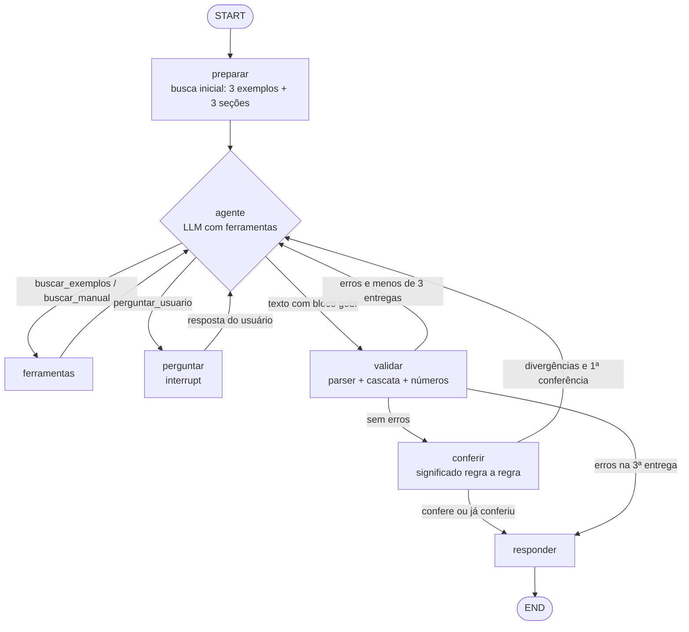
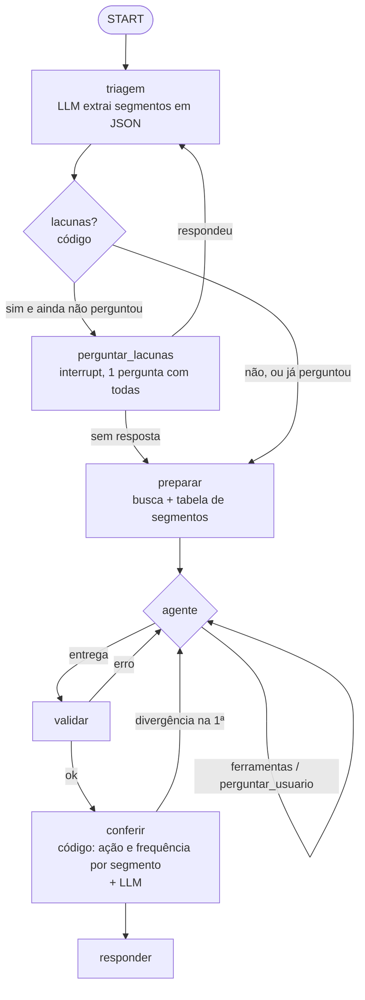

# Desenho: fluxo agêntico que gera a parametrização GoBR a partir de uma pergunta

Rascunho de 2026-11-17, para decisão do Pedro. Nada implementado. Parte do fluxo fixo da etapa anterior
(`gobr/agent.py`, commit `094e6b1`, relatório em `docs/relatorio_fluxo.md`).

## 1. O que muda em relação ao fluxo fixo

Hoje o grafo é um pipeline: `buscar → redigir → validar → (redigir | responder)`. O LLM não decide nada:
recebe 3 exemplos e 3 seções do manual uma vez, redige e, se o parser reclamar, redige de novo. Não pergunta
ao usuário e não confere se o `.gobr` diz o que o pedido pediu.

O enunciado pede um **agente de conversação** que seja **proativo** com os pontos falhos da modelagem. Os
quatro defeitos que a etapa anterior deixou (§4.2 do relatório) também pedem decisões que um pipeline não toma:

| Defeito (etapa anterior) | O que resolve no fluxo agêntico |
|---|---|
| Ação invertida no V1Vidros (`nao agendar` para "agendar inadimplentes autorizados") | Conferente de significado (§4) |
| InfinittoDesign com RAG inventa `atividade da empresa em N dias` | Busca no manual sob demanda, pela cláusula que falta |
| Maxlub termina com 17 linhas `#` de raciocínio | Remover comentários no pacote antes de validar (§5) |
| Pedido incompleto ou ambíguo seria redigido com chute | Ferramenta `perguntar_usuario` com `interrupt()` |

"Pergunta" aqui é a mensagem do usuário: pode ser um pedido completo (como os 3 gabaritos) ou parcial
("quero agendar os ativos toda semana"). O agente completa o que falta perguntando, até um limite.

## 2. Verificado antes de desenhar (2026-11-17)

- **Tool calling nativo funciona** no llama-server b11770 + Qwen3.6-35B-A3B com `--jinja`, com
  `reasoning_effort="none"`. Teste avulso (script fora do repositório), 4 casos: com `tool_choice` `auto` e `required`, o modelo
  chamou a ferramenta certa (`buscar_manual` para "consulte o manual", `perguntar_usuario` para "não sei o
  que é ativo") em 1 a 5 s, com `finish_reason=tool_calls` e argumentos JSON válidos. A volta com
  `role: tool` também funciona: o modelo usou o resultado e respondeu em texto.
  A doc `function-calling.md` do llama.cpp não lista Qwen3.x entre os formatos nativos; o teste mostra que o
  build do PC trata o template mesmo assim.
- **langgraph 1.2.20** instalado: `langgraph.types.interrupt` e `Command`, `InMemorySaver`
  (`langgraph.checkpoint.memory`), `ToolNode`/`tools_condition` (`langgraph-prebuilt` 1.1.1).
  `ToolNode` espera mensagens LangChain; sem `langchain-openai` (dispensado em
  `research/backend_llm_fluxo.md` §4), o despacho das ferramentas fica num nó próprio de ~15 linhas.
- **openai 3.49.0**: `chat.completions.create` aceita `tools`, `tool_choice`, `parallel_tool_calls`.

Não verificado: comportamento com `parallel_tool_calls=true` (o desenho usa uma chamada por vez), e quanto
o contexto de 32k aguenta numa conversa longa (§6 limita os passos).

## 3. Arquiteturas possíveis

| | A. ReAct livre | **B. Agente com guardas (recomendado)** | C. Triagem + pipeline fixo |
|---|---|---|---|
| Como é | LLM em laço com todas as ferramentas, inclusive `validar`; termina quando quer | LLM escolhe buscas e perguntas; a entrega passa sempre por validação e conferência determinadas pelo grafo | Um nó LLM decide "perguntar ou seguir"; depois o pipeline atual |
| Agêntico | Total | Nas buscas, perguntas e correções | Só na triagem |
| CASCADE-FIRST | Quebra: o LLM pode pular a validação | Mantém: o grafo valida tudo o que for entregue | Mantém |
| Risco | Laço longo, contexto estourado, entrega sem validar | Médio: o LLM pode buscar demais (limite de passos) | Baixo, mas não corrige a cláusula inventada nem pergunta depois de redigir |
| Esforço | Baixo | Médio | Baixo |

**Recomendo B.** A é o mais "agente", mas deixar a validação a critério do LLM contradiz a regra CASCADE-FIRST
do projeto. C muda pouco e não ataca três dos quatro defeitos acima.

## 4. O grafo (opção B)



Nós:

- **preparar** (determinístico): a busca de hoje (`retrieve`), para o LLM já começar com contexto. Mantém o
  resultado da etapa anterior como piso: se o agente não chamar nenhuma ferramenta, ele faz o mesmo que o
  fluxo fixo.
- **agente** (LLM): recebe o histórico de mensagens no formato OpenAI e as 3 ferramentas. Se responder com
  texto contendo um bloco ```gobr, isso é uma entrega.
- **ferramentas** (determinístico):
  - `buscar_exemplos(consulta)`: `index.search`, com o mesmo leave-out por assinatura da avaliação.
  - `buscar_manual(consulta)`: `manual_search.search`, híbrido, k=3. É o caminho para "existe cláusula
    para X?" antes de inventar uma.
  - `perguntar_usuario(pergunta)`: o roteador manda para o nó `perguntar`, que chama `interrupt()`.
- **perguntar**: `interrupt({"pergunta": ...})`. A CLI mostra a pergunta, lê a resposta e retoma com
  `Command(resume=resposta)`; a resposta volta ao agente como resultado da ferramenta. Exige checkpointer
  (`InMemorySaver`) e `thread_id`.
- **validar** (determinístico): o `check` atual, sem mudança. Erros voltam ao agente como mensagem de
  usuário ("o validador encontrou: ..."), como hoje.
- **conferir** (LLM, saída JSON): ver abaixo.
- **responder** (determinístico): o `respond` atual, mais as divergências que sobraram e as perguntas feitas.

### Conferente de significado

O validador garante sintaxe e números, não o significado (o V1Vidros passa com a ação invertida). O
conferente compara o pedido com o que o `.gobr` **faz**, e não com o que o LLM acha que escreveu:

1. O pacote (`gobr.context.build`) já descreve cada regra em português: `nome`, `acao_principal`,
   `condicao_efetiva` e as ações (frequência). A tabela vem daí, sem LLM.
2. Uma chamada separada ao LLM, com prompt próprio (`redator/prompt_conferente.md`) e
   `response_format` json_schema, devolve, por regra: o trecho do pedido que ela atende, `confere` (sim/não)
   e o motivo. Segmentos do pedido sem regra também saem.
3. Divergência na 1ª conferência volta ao agente para corrigir; na 2ª, vira alerta para o usuário.

O LLM só compara textos em português; quem diz o que a regra faz é a cascata. Isso segue CASCADE-FIRST,
mas é a primeira vez que um julgamento do LLM decide se uma entrega volta. Por isso fica limitado a uma volta
e sai na resposta como alerta, nunca como erro silencioso.

## 5. Estado, limites e ajustes no pacote

Estado novo (substitui o `State` atual):

| Campo | Para quê |
|---|---|
| `mensagens` | histórico OpenAI (system, user, assistant com `tool_calls`, tool) |
| `excluir` | leave-out da avaliação, como hoje |
| `gobr`, `notas` | a última entrega |
| `erros`, `alertas`, `divergencias` | saídas de validar e conferir |
| `passos`, `entregas`, `perguntas`, `conferencias` | contadores dos limites |
| `resposta` | texto final |

Limites (para não estourar 32k de contexto nem o tempo):

- `MAX_PASSOS = 8` chamadas do agente; `MAX_ENTREGAS = 3` (hoje são 2 tentativas);
  `MAX_PERGUNTAS = 2`; uma conferência com volta.
- Ao bater um limite de passos ou perguntas, a ferramenta devolve "limite atingido, entregue o que tiver" em
  vez de executar.
- Resultado de busca entra resumido: descrição + `.gobr` do exemplo, sem os chunks repetidos.

Ajuste no pacote: linhas `#` no corpo do `.gobr` gerado são removidas antes de validar (o comentário do
cabeçalho pode ficar). É uma regra de limpeza, não de prompt.

## 6. Avaliação

1. **Gabaritos (regressão):** `avaliar-agente` nos 3 casos, mesmo critério "cobertura + parse". Piso: 2/3 e
   185 s do fluxo fixo. Meta: 3/3, e a ação do V1Vidros certa.
2. **Perguntas:** um arquivo novo `data/agente/casos_pergunta.json` com ~6 pedidos, metade completos e metade
   faltando algo (frequência ausente, segmento sem critério, "inadimplentes" sem dizer se agenda). Cada caso
   traz a resposta que um usuário simulado dá, lida do arquivo (sem LLM no papel do usuário). Mede-se:
   perguntou quando faltava, não perguntou quando estava completo, e o `.gobr` final passa no `check`.
3. **Conferente:** rodar só o conferente nas 6 entregas da etapa anterior (`data/agente/`), em que já se sabe
   onde está a ação invertida. Mede se ele acusa o V1Vidros e se acusa alguma regra certa (falso positivo).

Na avaliação em lote, sem gente, `perguntar_usuario` responde com o texto do caso ou, se não houver, com "sem
resposta: siga com a premissa mais provável e diga qual foi nas notas".

## 7. Arquivos que a implementação tocaria

- `gobr/agent.py`: grafo novo; `check`, `retrieve`, `requested_numbers` ficam. `Chat` passa a devolver a
  mensagem (texto + `tool_calls`), não só o texto. O fluxo fixo sai: a linha de base é o commit `094e6b1`.
- `redator/prompt_agente.md`: quando buscar, quando perguntar, formato da entrega.
- `redator/prompt_conferente.md` (novo).
- `gobr/__main__.py`: `agente` vira conversa no terminal (laço de `interrupt`/`Command`); comandos novos
  `avaliar-perguntas` (casos com respostas simuladas; na implementação, ficou um comando separado em vez
  de `avaliar-agente --casos`) e `conferir` (só o conferente, para §6.3).
- `tests/test_agent.py`: LLM falso que devolve `tool_calls` roteirizadas; testes do roteamento, dos limites,
  da remoção de `#` e do retorno do `interrupt`.
- `docs/relatorio_agente.md` (novo) e a entrega em PDF, como nas etapas anteriores.

Fora deste desenho: entrada por imagem (`mmproj`). Cabe no nó `preparar` sem mudar o grafo, e fica para
depois que este fluxo passar na avaliação.

## 8. Decisões

1. Arquitetura: **B** (Pedro, 2026-11-17).
2. Conferente de significado com LLM: **entra** (Pedro, 2026-11-17, "B, com conferente").
3. O fluxo fixo foi substituído; a linha de base é o commit `094e6b1` (padrão deste desenho, sem objeção).

Ajustes feitos na implementação:
- A tabela do conferente mostra também o código dos filtros e os bloqueios anteriores de cada regra. Só
  com a `condicao_efetiva`, ele acusava dois falsos positivos nas entregas antigas do Maxlub: "prospect"
  aparece como "nunca compraram" (P5), e a exclusão da rota feita por um bloqueio não aparece na condição.

## 9. Triagem estruturada (desenho e implementação de 2026-11-17)

Implementada como desenhada, com as diferenças de §9.9. Resultados em `docs/relatorio_agente.md` §4.4.

**Problema** (`docs/relatorio_agente.md` §4.2): quando falta um dado no
pedido, o agente inventa em vez de perguntar (0 de 3 casos). O validador não pega porque os números do
pedido estão lá, e o conferente não pega porque procura contradição, não ausência. Duas versões de prompt
não resolveram.

**Ideia:** tirar do LLM a decisão de perguntar. O LLM só extrai os segmentos do pedido em JSON. O código
decide se falta algo, monta a pergunta e, depois da entrega, compara cada regra com o seu segmento.

### 9.1 Grafo



Os nós `agente`, `ferramentas`, `perguntar`, `validar` e `responder` são os de antes. Entram dois nós novos
(`triagem` e `perguntar_lacunas`), e `conferir` passa a comparar também os segmentos (§9.4).

### 9.2 Triagem (LLM, `response_format` json_schema)

Prompt próprio (`redator/prompt_triagem.md`). A entrada é o pedido e, depois da pergunta, as respostas do
usuário. A saída é uma lista de segmentos:

| campo | tipo | "não informado" |
|---|---|---|
| `segmento` | texto: o nome como está no pedido | nunca vazio |
| `trecho` | texto: a linha do pedido | nunca vazio |
| `criterio` | texto: quem são os clientes, nas palavras do pedido | `""` |
| `acao` | `"agendar"`, `"nao_agendar"` ou `"indefinido"` | `"indefinido"` |
| `frequencia_dias` | inteiro | `0` |

- Sem campos nulos de propósito: a doc do llama.cpp não diz se `"type": [..., "null"]` funciona e avisa que
  recurso sem suporte é ignorado em silêncio. Os valores "não informado" são fixos, e o código confere
  cada um (um `acao` fora da lista vira `"indefinido"`).
- O prompt diz o que é frequência: "o número de dias entre agendamentos, só quando o pedido o dá para
  aquele segmento". Um número que descreve o critério ("há mais de 30 dias sem compra") não é frequência.
  Esta é a parte mais frágil (§9.6).

### 9.3 Lacunas e pergunta (código)

Lacunas, por segmento:
- `acao == "indefinido"`: "agendar ou não agendar?";
- `acao == "agendar"` e `frequencia_dias == 0`: "de quantos em quantos dias?";
- `criterio == ""`, exceto em segmento residual ("demais", "os demais", "restantes"): "quem são esses
  clientes?".

Há no máximo uma rodada de perguntas da triagem: uma só pergunta, montada por template a partir das lacunas
(uma linha por lacuna), via `interrupt`. A resposta volta para a triagem, que extrai de novo com o pedido e
a resposta. Se ainda faltar algo, o agente segue e a lacuna vira alerta ("o pedido não deu a frequência de
X; o arquivo usa N"). Essa pergunta não conta no limite de 2 do `perguntar_usuario`, que fica para as
perguntas de modelagem.

Os segmentos confirmados entram na 1ª mensagem do agente como uma tabela `<segmentos>`, para ele redigir a
partir dos valores confirmados, e não do texto solto.

### 9.4 Conferir segmentos (código, depois do validador)

Para cada regra do pacote, o código acha o segmento de mesmo nome (`gobr.text.fold` nos dois lados) e
compara:
- a ação: `nao_agendar` no pacote contra `acao` do segmento;
- a frequência: o `dias_equivalentes` da ação `frequencia` (`catalogue`) contra `frequencia_dias`.

Uma diferença vira divergência, no mesmo canal do conferente: volta ao agente uma vez e depois vai para a
resposta. Regra sem segmento de mesmo nome não é julgada aqui; fica com o conferente LLM. O código não
afirma "sem regra" porque os nomes variam.

Isso pega, por exemplo, os 14 dias copiados dos ativos para os inativos, que o conferente aprovou duas vezes.

### 9.5 Custo

- Uma chamada a mais por pedido, duas quando há pergunta. Estimativa: 15 a 20 s cada, pelo tempo do
  conferente (≈17 s por arquivo); não medido.
- Código: ~80 linhas em `gobr/agent.py` (2 nós, `gaps`, `match_segments`), um prompt e testes.

### 9.6 Riscos

- **Ambiguidade do formato:** em "Inativos: sem compra há mais de 30 dias", o 30 pode ser extraído como
  frequência. Aí não há lacuna e não há pergunta. O caso `falta_frequencia` mede exatamente isso.
- **Perguntar demais:** pedidos reais trazem segmentos sem frequência (o V1Vidros tem "Agendar inadimplentes"
  sem dias). Na avaliação em lote a resposta é "sem resposta", o que custa uma chamada sem ganho na nota.
- **Nome da regra ≠ nome do segmento:** a comparação por nome falha em silêncio, sem falso positivo, só
  sem cobertura. O prompt do agente já pede o nome do segmento como nome da regra.

### 9.7 Avaliação e critério de sucesso

Mesmos casos, mesmos comandos (`avaliar-perguntas` e `avaliar-agente`), mais duas colunas: lacunas
detectadas e divergências de segmento.

Sucesso:
- pergunta em pelo menos 2 dos 3 casos incompletos;
- não pergunta em nenhum dos 3 completos;
- mantém os 3/3 nos gabaritos.

Se não atingir, a triagem fica registrada como tentativa e a etapa fecha como está.

Antes de implementar, testes [P] com saídas escritas à mão:
- `gaps` nos 6 segmentos de `casos_pergunta.json`;
- `match_segments` com ação invertida, frequência copiada e nome diferente (este não pode acusar).

### 9.8 Arquivos

- `gobr/agent.py`: os nós `triagem`, `perguntar_lacunas` e `conferir_segmentos`; as funções `gaps` e
  `match_segments`; o estado ganha `segmentos` e `lacunas`.
- `redator/prompt_triagem.md` (novo).
- `tests/test_agent.py`: o LLM falso responde também à triagem (pelo `schema`), e há testes das lacunas,
  da pergunta e da comparação.
- `gobr/__main__.py`: as colunas novas em `avaliar-perguntas` e `avaliar-agente`.
- Relatório, avaliação e README, depois de medir.

### 9.9 O que mudou na implementação

- **Ordem:** a triagem roda antes de `preparar` (START → triagem → [perguntar_lacunas → triagem] →
  preparar), para a tabela `<segmentos>` entrar na 1ª mensagem do agente.
- **Sem nó `conferir_segmentos`:** `match_segments` roda dentro de `conferir`, antes do LLM; as divergências
  do código ficam também em `divergencias_codigo`, para a avaliação separar "código + LLM".
- **Nome do segmento:** igual (dobrado) ou o nome da regra começando por "<segmento>:" ("Ativos: compra
  nos últimos 30 dias"). A 1ª versão aceitava qualquer prefixo, e o code-auditor mostrou falso positivo
  ("Ativos inadimplentes" julgada como "Ativos").
- **Frequência da regra:** "frequencia de N dias" (1ª opção, quando há "ou") ou `dias_equivalentes` das
  frequências fixas (`semanal()` = 7). O `dias_equivalentes` sozinho não cobre "de N dias".
- **Residual:** só pelo nome do segmento, com "demais" e "restantes".
- **Aviso de lacuna:** distingue "sem resposta do usuário" de "a resposta não resolveu"; não diz o valor
  que o arquivo usou (fica para depois).
- **Prompt da triagem:** depois da 1ª sonda nos 6 casos, ganhou a regra "linha sem frequência nem bloqueio
  → `indefinido`" (o `falta_frequencia` virava `nao_agendar`). Ajuste feito vendo um caso da avaliação.
